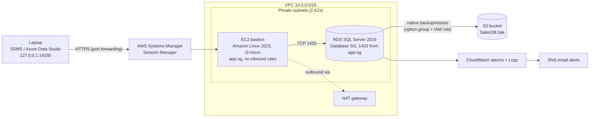

# Deploying SQL Server Databases on Amazon RDS

A hands-on AWS project that deploys a **SQL Server 2019** database on **Amazon RDS** inside private subnets, reaches it securely through an **SSM Session Manager bastion** (no open inbound ports), and adds native **backup/restore to S3**, least-privilege access, and **CloudWatch monitoring**.

  -blue)

---

## Table of contents

1. [Architecture](#architecture)
2. [Services used](#services-used)
3. [Prerequisites](#prerequisites)
4. [Repository structure](#repository-structure)
5. [Deployment steps](#deployment-steps)
6. [Validation checklist](#validation-checklist)
7. [Troubleshooting log](#troubleshooting-log)
8. [Security considerations](#security-considerations)
9. [Cost and cleanup](#cost-and-cleanup)
10. [Lessons learned](#lessons-learned)
11. [Future improvements](#future-improvements)

---

## Architecture



**Key design decisions**

- The database sits in **private subnets** and is not exposed to the internet.
- A laptop cannot reach private subnets directly, so access goes through an **SSM port-forwarding session** to a bastion EC2 instance. No SSH keys, no RDP, no inbound ports.
- The database security group allows **port 1433 only from the bastion's security group**.
- Applications use a **least-privilege login**, not the master user.

---

## Services used

| Service | Purpose |
|---|---|
| Amazon VPC | Network, subnets, route tables, NAT gateway |
| Amazon RDS for SQL Server | Managed SQL Server 2019 instance |
| Amazon EC2 | Bastion host (Amazon Linux 2023, `t3.micro`) |
| AWS Systems Manager | Session Manager port forwarding |
| Amazon S3 | Stores native `.bak` backups |
| AWS IAM | Roles and policies for the bastion and for RDS-to-S3 access |
| Amazon CloudWatch | Alarms, metrics, and exported error logs |
| Amazon SNS | Email notifications for alarms and RDS events |

---

## Prerequisites

- An AWS account with permissions for the services above
- Region: **Asia Pacific (Osaka) `ap-northeast-3`**
- [AWS CLI v2](https://aws.amazon.com/cli/) configured (`aws configure`)
- [Session Manager plugin](https://docs.aws.amazon.com/systems-manager/latest/userguide/session-manager-working-with-install-plugin.html) for the AWS CLI
- SQL Server Management Studio (SSMS) or Azure Data Studio

---

## Repository structure

```
rds-sqlserver-deployment/
├── README.md
├── .gitignore
├── docs/
│   ├── architecture.png
│   └── troubleshooting.md
├── screenshots/
├── iam/
│   └── rds-sqlserver-s3-policy.json
├── sql/
│   ├── 01-create-database.sql
│   ├── 02-create-app-user.sql
│   ├── 03-backup-restore.sql
│   └── 04-validation.sql
└── scripts/
    └── start-ssm-tunnel.bat
```

---

## Deployment steps

> Replace every value in `<angle brackets>` with your own. Never commit real passwords, keys, account IDs, or endpoints.

### 1. Networking

1. Create a VPC (`10.0.0.0/16`) with two public and two private subnets across two Availability Zones and one NAT gateway.
2. Create a **DB subnet group** (`sqlserver-subnet-group`) using the private subnets.
3. Create two security groups:

| Security group | Inbound rule | Source |
|---|---|---|
| `app-sg` (bastion) | none | n/a |
| Database SG | MSSQL, TCP 1433 | `app-sg` |

Never open port 1433 to `0.0.0.0/0`.

### 2. Create the RDS instance

| Setting | Value |
|---|---|
| Engine | Microsoft SQL Server 2019 (`15.00`) |
| Identifier | `sqlserver-prod-01` |
| Master username | `admin` (not `sa`) |
| Storage | gp3, encryption enabled, storage autoscaling on |
| Network | Private subnets, DB subnet group above |
| Public access | **No** |
| Security group | Database SG |
| Port | 1433 |
| Backup retention | 7 days |
| Monitoring | Enhanced Monitoring on, error log exported to CloudWatch |

### 3. Create the SSM bastion

1. **IAM role** `bastion-ssm-role` (EC2 trusted entity) with the `AmazonSSMManagedInstanceCore` policy.
2. **Launch EC2:** Amazon Linux 2023, `t3.micro`, no key pair, in a private subnet with a NAT route, security group `app-sg`, no public IP, instance profile `bastion-ssm-role`.
3. Wait until the instance shows **Online** in **Systems Manager → Fleet Manager**.

### 4. Start the tunnel

`scripts/start-ssm-tunnel.bat`:

```bat
aws ssm start-session ^
  --target <bastion-instance-id> ^
  --region ap-northeast-3 ^
  --document-name AWS-StartPortForwardingSessionToRemoteHost ^
  --parameters "{\"host\":[\"<rds-endpoint>\"],\"portNumber\":[\"1433\"],\"localPortNumber\":[\"14330\"]}"
```

Wait for `Waiting for connections...` and **leave the window open**.

### 5. Connect with SSMS

| Field | Value |
|---|---|
| Server name | `127.0.0.1,14330` |
| Authentication | SQL Server Authentication |
| Login | `admin` |
| Encrypt | Optional, or Mandatory with **Trust server certificate** ticked |

Use `127.0.0.1` rather than `localhost`, which can resolve to IPv6.

Verify:

```sql
SELECT @@VERSION;
SELECT name FROM sys.databases;
```

### 6. Create a database and a least-privilege user

`sql/01-create-database.sql`

```sql
CREATE DATABASE SalesDB;
GO
USE SalesDB;
GO
CREATE TABLE Customers (
    CustomerID INT IDENTITY PRIMARY KEY,
    Name NVARCHAR(100),
    Email NVARCHAR(150)
);
GO
INSERT INTO Customers (Name, Email) VALUES
('Ada Obi', 'ada@example.com'),
('Chidi Eze', 'chidi@example.com'),
('Ngozi Bello', 'ngozi@example.com');
GO
```

`sql/02-create-app-user.sql`

```sql
CREATE LOGIN app_user WITH PASSWORD = '<STRONG_PASSWORD>';
GO
USE SalesDB;
GO
CREATE USER app_user FOR LOGIN app_user;
ALTER ROLE db_datareader ADD MEMBER app_user;
ALTER ROLE db_datawriter ADD MEMBER app_user;
GO
```

**Test as `app_user`** (open the query window from the `app_user` connection and check the status bar):

```sql
USE SalesDB;
SELECT * FROM Customers;                                          -- works
INSERT INTO Customers (Name, Email) VALUES ('Test', 't@example.com'); -- works
DROP TABLE Customers;                                             -- fails (Msg 3701)
```

### 7. Native backup and restore with S3

1. **S3 bucket** `<your-backup-bucket>` in the same Region, with **Block all public access** on.
2. **IAM policy** `rds-sqlserver-s3-policy` (`iam/rds-sqlserver-s3-policy.json`):

```json
{
  "Version": "2012-10-17",
  "Statement": [
    {
      "Effect": "Allow",
      "Action": ["s3:ListBucket", "s3:GetBucketLocation"],
      "Resource": "arn:aws:s3:::<your-backup-bucket>"
    },
    {
      "Effect": "Allow",
      "Action": [
        "s3:GetObject",
        "s3:PutObject",
        "s3:AbortMultipartUpload",
        "s3:ListMultipartUploadParts"
      ],
      "Resource": "arn:aws:s3:::<your-backup-bucket>/*"
    }
  ]
}
```

3. **IAM role** `rds-sqlserver-s3-role` with `rds.amazonaws.com` as the trusted principal and the policy above attached.
4. **Option group:** engine **sqlserver** matching your edition, major version **15.00**. Add the option `SQLSERVER_BACKUP_RESTORE` with the role above, then attach the group to the instance (**Modify → Apply immediately**) and wait for **in-sync**.
5. Run `sql/03-backup-restore.sql` as `admin`:

```sql
-- Back up to S3
EXEC msdb.dbo.rds_backup_database
    @source_db_name = 'SalesDB',
    @s3_arn_to_backup_to = 'arn:aws:s3:::<your-backup-bucket>/SalesDB.bak',
    @overwrite_s3_backup_file = 1;

-- Check progress until lifecycle = SUCCESS
EXEC msdb.dbo.rds_task_status @db_name = 'SalesDB';

-- Restore under a new name to prove the backup works
EXEC msdb.dbo.rds_restore_database
    @restore_db_name = 'SalesDB_Restored',
    @s3_arn_to_restore_from = 'arn:aws:s3:::<your-backup-bucket>/SalesDB.bak';

EXEC msdb.dbo.rds_task_status @db_name = 'SalesDB_Restored';
```

### 8. Backups, snapshots, and monitoring

- Automated backups: retention **7 days**.
- Manual snapshot: `sqlserver-prod-01-manual-1`.
- **SNS topic** `rds-alerts` with a confirmed email subscription.
- **CloudWatch alarms** (all notify `rds-alerts`):

| Alarm | Metric | Condition |
|---|---|---|
| Low Storage Alarm | `FreeStorageSpace` | Lower than about 20% of allocated storage |
| High CPU Alarm | `CPUUtilization` | Greater than 80%, 2 of 2 datapoints |
| High Connections Alarm | `DatabaseConnections` | Greater than threshold for the instance class |

- **Log export:** SQL Server error log to CloudWatch Logs (`/aws/rds/instance/sqlserver-prod-01/error`). The Agent log was not offered for this configuration.
- **RDS event subscription** for availability, failure, low storage, maintenance, and backup events.

### 9. Lock it down

- Set **Public access: Not publicly accessible**.
- Confirm the database security group has a single inbound rule: MSSQL 1433 from the bastion's security group.

---

## Validation checklist

- [x] Instance **Available**, engine SQL Server 2019
- [x] Connected through the SSM tunnel (`127.0.0.1,14330`)
- [x] `SalesDB` created with sample data
- [x] `app_user` can read and write but cannot drop tables
- [x] `SalesDB.bak` created in S3 and restored as `SalesDB_Restored`
- [x] Manual snapshot available, retention 7 days or more
- [x] CloudWatch alarms in **OK** state, SNS subscription confirmed
- [x] Instance is **not publicly accessible**
- [x] Database security group allows only the bastion SG on port 1433

---

## Troubleshooting log

| Symptom | Cause | Fix |
|---|---|---|
| Option dropdown showed `MARIADB_AUDIT_PLUGIN` | Option group was created with the MySQL engine | Deleted it and recreated with a **SQL Server** engine, major version `15.00` |
| SSMS error **258** (wait operation timed out) | Instance in private subnets, no route from the internet; the NAT gateway only handles outbound traffic | Used an SSM bastion with port forwarding |
| `Test-NetConnection` not recognized | Command run in Command Prompt instead of PowerShell | Ran it as `powershell Test-NetConnection ...` |
| SSMS error **1225** (connection refused) | Stale or interrupted tunnel session; `localhost` can resolve to IPv6 | Restarted the tunnel, used `127.0.0.1,14330` |
| `nc` from the bastion connected successfully | Confirmed the bastion-to-RDS path and security group were correct | Isolated the fault to the local tunnel |
| `Login failed for user 'app_user'` (**18456**) | Password mismatch in the login dialog | Reset with `ALTER LOGIN` and re-entered it |
| `DROP TABLE` test succeeded unexpectedly | Query window was connected as `admin`, not `app_user` | Recreated the table, reran the test from the `app_user` connection |
| "Database backup/restore option is not enabled" | Option group not yet attached or still applying | Attached the option group and waited for **in-sync** |
| Agent log not available | Not offered for this edition/configuration | Exported the error log only |

---

## Security considerations

- Database in private subnets, encrypted at rest, not publicly accessible
- No inbound ports on the bastion; access is IAM-authenticated through Session Manager
- Security group references (bastion SG to database SG) instead of IP ranges
- Master user used only for administration; applications use `app_user`
- S3 bucket blocks all public access; IAM policy scoped to one bucket
- Credentials, account IDs, and endpoints are kept out of the repository

---

## Cost and cleanup

The **RDS instance**, **NAT gateway** (plus its Elastic IP), and **bastion EC2** bill by the hour. Delete them when finished, in this order:

1. Close SSMS and stop the tunnel (`Ctrl+C`).
2. Delete the RDS instance (disable deletion protection first; decide whether to keep a final snapshot).
3. Delete manual snapshots.
4. Terminate the bastion EC2 instance.
5. Delete the NAT gateway, then release the Elastic IP.
6. Empty and delete the S3 bucket.
7. Delete the CloudWatch alarms, log groups, SNS topic, and RDS event subscription.
8. Delete the option group, IAM roles and policies, and the VPC if it was created only for this project.
9. Check **Billing → Bills** a day later to confirm nothing is still running.

---

## Lessons learned

- A **public IP on an RDS instance is useless** without a route to an internet gateway; a NAT gateway does not allow inbound traffic.
- Error codes tell you where the problem is: **258** means the network path never opened, **1225** means something reached but refused, **18456** means the server rejected the login.
- Each SSMS query window is tied to the connection it was opened from, so always check the status bar before running anything destructive.
- RDS does not grant `sysadmin`, so native `RESTORE DATABASE` does not work; use the `rds_backup_database` and `rds_restore_database` procedures.
- Option groups cannot change engine after creation, so check the engine and major version when creating them.

---

## Future improvements

- Automate the build with **Terraform** or **CloudFormation**
- Add **Multi-AZ** (Standard/Enterprise editions) and test failover
- Store credentials in **AWS Secrets Manager** with rotation
- Enforce SSL with `rds.force_ssl` in a custom parameter group
- Add scheduled backups to S3 with a SQL Server Agent job or AWS Backup
- Migrate with **AWS DMS** for minimal-downtime scenarios

---

## License

MIT (add a `LICENSE` file if you make the repository public).
